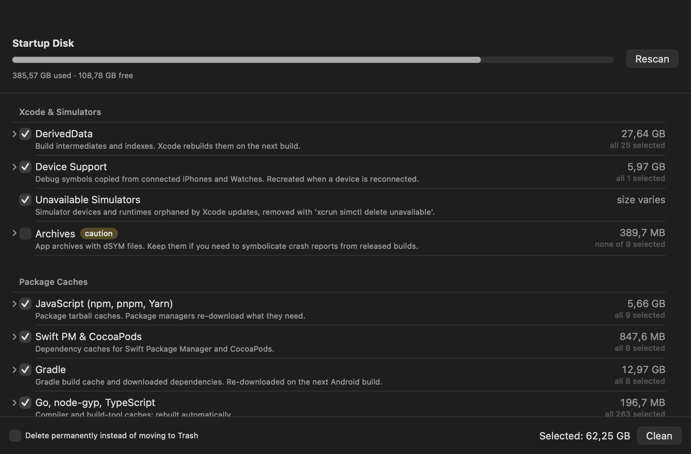

<p align="center">
  
</p>

<h1 align="center">SuperMinimalTools</h1>

<p align="center">A super-minimal macOS menu bar utility: CPU temperature, network speed, and a developer-focused disk cleaner. No Electron, no subscriptions, no telemetry — one tiny native app.</p>

<p align="center">
  
</p>

<p align="center">
  
</p>

## Features

**📊 Menu bar stats** — live in your status bar, updated every 2 seconds:

- **CPU temperature** — the average CPU die temperature read from the SMC (the same source the Stats app uses), with an IOHID fallback.
- **Network speed** — ↓ download (blue) and ↑ upload (red) across your physical interfaces.
- Each metric can be shown or hidden from the dropdown.

**🧹 Disk Cleaner** — built for developers whose 512 GB disk is always at 95%:

- Scans a **curated catalog** of known junk locations: Xcode DerivedData, Device Support, previews & simulator caches, old simulators, Archives, npm/pnpm/Yarn/Bun/SwiftPM/CocoaPods/Gradle/Cargo/Maven/pub (Flutter)/Homebrew caches, app & browser caches, VS Code/Cursor/Slack/Discord caches, AI model caches, Android emulators & system images, iPhone backups, Docker, logs, and Trash.
- **Project folders**: finds `node_modules`, `Pods` and build outputs (Flutter `build`/`.dart_tool`, Rust `target`, Gradle, Next.js `.next`) in `~/Developer`, `~/Projects`, `~/Documents`… — a `build` folder only counts when its project file (`pubspec.yaml`, `build.gradle`…) sits next to it.
- **Personal files**: leftover installers (`.dmg`, `.pkg`, `.xip`, `.ipsw`) and files over 500 MB in Downloads, Desktop, Documents and Movies.
- **Browse Folders**: a disk-usage browser — start anywhere (home, Library, Developer, any folder), see children sorted by size, drill in, tick items across several folders and move them to the Trash in one go. Standard macOS folders (`~/Library`, `~/Documents`, `~/Library/Caches`…), `.ssh`, Keychains and anything outside your home are protected and can only be viewed.
- **Per-item selection**: expand any category and keep exactly what you need (e.g. keep the DerivedData of the project you're working on).
- **Trash-first**: everything is moved to the Trash unless you explicitly choose permanent deletion. External tools (simulators, Homebrew, Docker) are cleaned via their own CLIs (`simctl`, `brew cleanup`, `docker system prune`) — never raw file deletion.
- Risky categories (Archives, ML models, Docker, emulators, backups, `node_modules`, personal files) are marked **caution** and unchecked by default.
- Disabled by default; enabling walks you through granting Full Disk Access.

## Requirements

- macOS 15 (Sequoia) or newer
- CPU temperature requires Apple Silicon (Intel Macs show `--°`; everything else works)

## Install

### Build from source

```bash
git clone https://github.com/phanvantai/SuperMinimalTools.git
cd SuperMinimalTools
xcodebuild -project SuperMinimalTools.xcodeproj \
           -scheme SuperMinimalTools -configuration Release build
```

Or open `SuperMinimalTools.xcodeproj` in Xcode and press ⌘R.

### First launch

If you downloaded a build instead of compiling it yourself, macOS Gatekeeper may block it: right-click the app → **Open** → **Open**.

## Permissions & privacy

- **Full Disk Access** is requested only when you enable the Disk Cleaner — macOS protects locations like the Trash and browser caches. The scan is read-only; nothing is deleted until you press Clean and confirm.
- **No sandbox**: reading CPU temperature (SMC/IOKit) and cleaning caches outside the app's own container are impossible in a sandboxed app. This is also why the app can't be on the Mac App Store.
- No network calls, no analytics, no data collection. The only thing the app uploads is nothing.

## How it works

| Feature | Implementation |
|---|---|
| CPU temperature | SMC `Tp*` die-temperature keys via the AppleSMC user client; IOHID thermal sensors as fallback |
| Network speed | `getifaddrs` byte counters over `en*` interfaces, sampled every 2 s |
| Disk scanning | `FileManager` enumeration of a hard-coded catalog, sizes from `totalFileAllocatedSize` |
| Deletion | `FileManager.trashItem` (recoverable) or `removeItem` (opt-in permanent) |

## License

[MIT](LICENSE)
